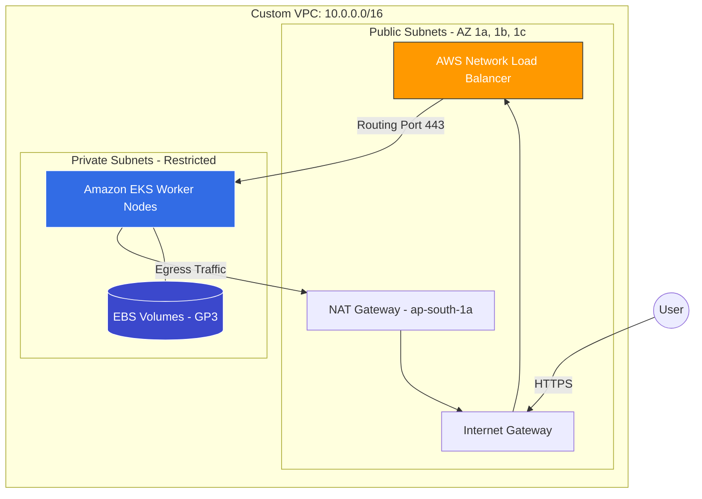
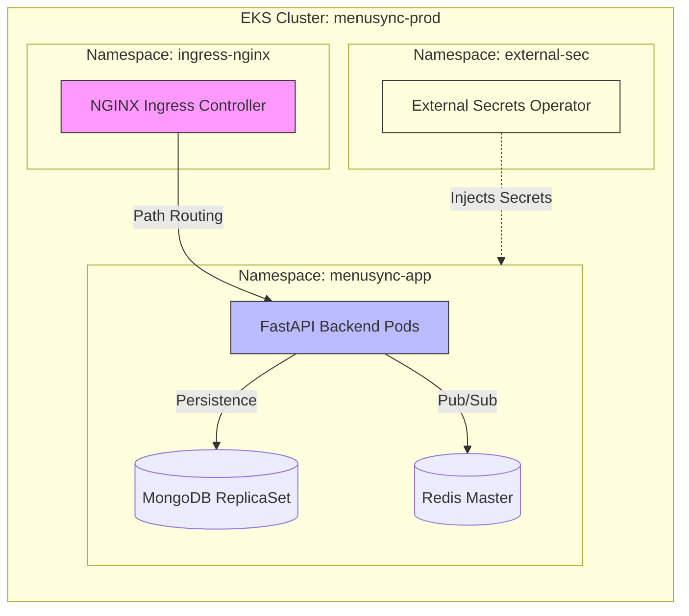
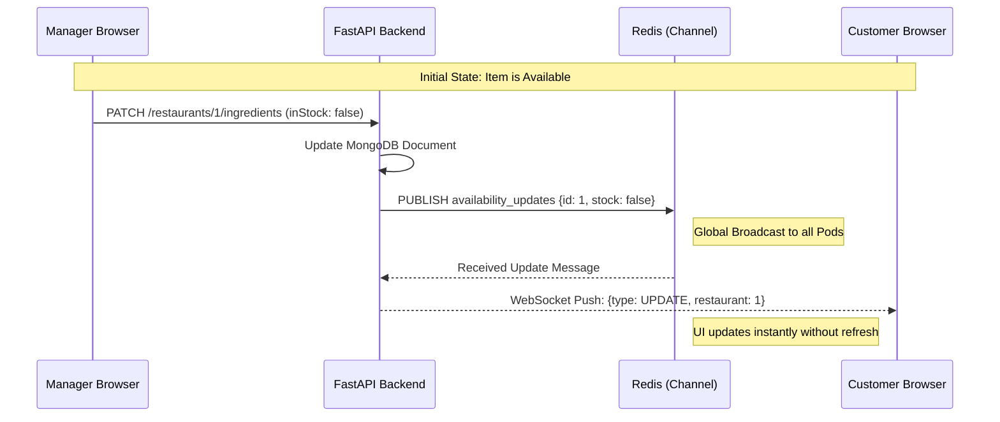
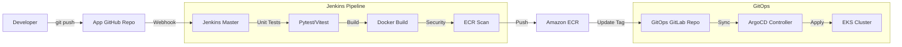

# Professional Architecture & Workflow Diagrams

This document provides a multi-layer visualization of the MenuSync platform, from high-level cloud infrastructure to low-level real-time data flows.

---

## 1. Cloud Infrastructure Layer (Physical)
*AWS Network topology and resource isolation.*

---

## 2. Cluster Logical Layer (Kubernetes)
*Namespace isolation and workload orchestration.*

---

## 3. Real-Time Data Flow (WebSockets)
*Sequence of events for a sub-5s menu update.*

---

## 4. Automation & GitOps Pipeline
*The software delivery lifecycle.*

