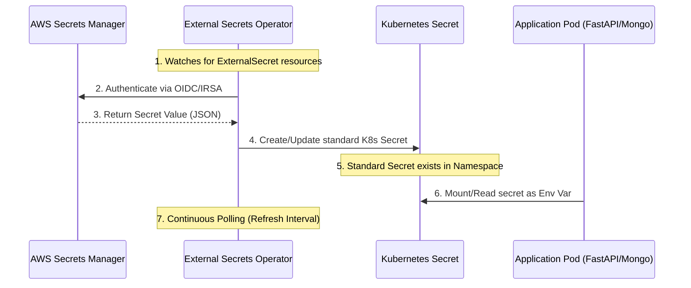

# Technical Deep Dive: External Secrets & Security Architecture

This document explains the technical implementation and workflow of the **External Secrets Operator (ESO)** within the MenuSync ecosystem. By moving away from Terraform-managed secrets, we have implemented an "Enterprise-Grade" security pattern.

---

## 🏗️ The Problem: The "Secret-in-State" Vulnerability
Before this migration, Terraform was responsible for fetching secrets from AWS and creating `kubernetes_secret` resources.
*   **The Issue:** Terraform must store the values it manages in its `terraform.tfstate` file to track changes.
*   **The Risk:** Even if the state file is in S3, it contains your production database and Redis passwords in **plain text**. Any DevOps engineer or process with read access to that bucket can compromise the entire system.

---

## 🛡️ The Solution: External Secrets Operator (ESO)
We introduced ESO to decouple the **Infrastructure (Terraform)** from the **Data (Secrets)**. Terraform now only manages the **Identity** (IAM Role), while the operator handles the **Synchronization**.

### 1. The Security Identity (IRSA)
We use **IAM Roles for Service Accounts (IRSA)** to bridge AWS and Kubernetes without using long-lived access keys.
1.  **OIDC Provider:** EKS has an OpenID Connect provider that AWS trusts.
2.  **IAM Role:** A role is created with a "Trust Relationship" allowing the EKS OIDC provider to assume it.
3.  **Annotation:** The Kubernetes ServiceAccount is annotated with the IAM Role ARN.
4.  **Token Injection:** When the ESO pod starts, EKS automatically injects a temporary AWS token into the pod.

### 2. The Technical Workflow
The lifecycle of a secret in MenuSync now follows this automated loop:

1.  **Manifest Definition:** We commit an `ExternalSecret` YAML to Git. It contains no passwords, only references (e.g., "Get `password` from AWS secret `mongo-secrets`").
2.  **Discovery:** ESO sees the new resource and looks at the `ClusterSecretStore` to find the AWS connection details.
3.  **Retrieval:** ESO uses its IRSA identity to call the AWS `GetSecretValue` API.
4.  **Mapping:** ESO parses the JSON from AWS and maps the fields into a standard Kubernetes `Secret`.
5.  **Synchronization:** ESO polls AWS every hour. If you change a password in the AWS Console, the Kubernetes secret is updated automatically without a `terraform apply`.

---

## 📂 Implementation Checklist (What changed?)

| Component | Location | Technical Purpose |
| :--- | :--- | :--- |
| **IAM Module** | `Infrastructure/modules/external-secrets` | Defines the secure AWS identity for the cluster. |
| **App-of-Apps** | `GITOPS/apps/infra-apps/` | Bootstraps the Operator and its configuration manifests. |
| **SecretStore** | `GITOPS/apps-config/external-secrets/` | The bridge configuration connecting K8s to the `ap-south-1` region. |
| **Mappings** | `GITOPS/apps-config/external-secrets/` | Individual `ExternalSecret` resources for MongoDB, Redis, and Grafana. |

---

## ✅ Benefits Summary
*   **Zero-Knowledge State:** Sensitive values never enter the `terraform.tfstate` or the Git history.
*   **Automatic Rotation:** Supports AWS Secret Rotation out-of-the-box.
*   **Auditability:** All secret access is logged in **AWS CloudTrail**, showing exactly when the EKS cluster fetched a value.
*   **Portability:** To change a password, you only touch the AWS Console; the infrastructure remains immutable.
