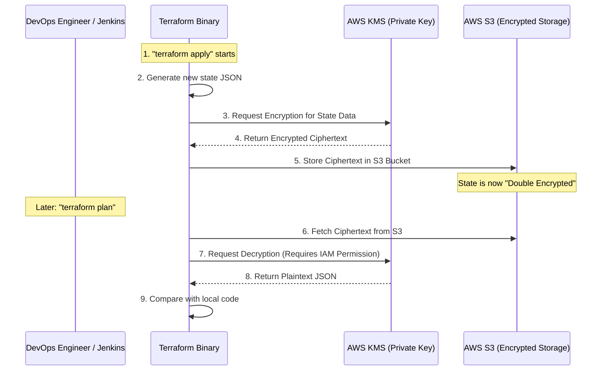

# Technical Deep Dive: Terraform State Hardening & KMS Encryption

This document explains the security implementation used to protect the **MenuSync bootstrap credentials** (ArgoCD SSH keys, webhook tokens, etc.) by using a Customer Managed Key (CMK) in AWS KMS.

---

## 🏗️ The Problem: S3 Default Encryption vs. High-Value Targets
By default, Terraform state files in S3 are often encrypted using AWS-managed keys (SSE-S3). 
*   **The Limitation:** Anyone with standard "S3 Read" permissions in the AWS account can download and decrypt the state file automatically.
*   **The Risk:** Since ArgoCD requires an initial "bootstrap" via Terraform (SSH keys to clone the repository), these high-value secrets are stored in the state file. A simple S3 misconfiguration could leak your entire GitOps foundation.

---

## 🛡️ The Solution: Double-Layer KMS Encryption
We implemented a **Customer Managed Key (CMK)** approach. This adds a "Lock on top of the Safe."

### 1. The Implementation Logic
1.  **Isolated Module:** We created `Infrastructure/modules/kms` to keep encryption management separate from networking or compute.
2.  **Key Rotation:** Enabled `enable_key_rotation = true` as a security best practice.
3.  **Alias Mapping:** Created an alias (`alias/menusync-prod-state-key`) so the backend configuration remains human-readable and doesn't break if the underlying Key ID changes.

### 2. The Technical Workflow
The encryption/decryption cycle follows this secure path:

### 3. Why this is "Elite" Security
Even if an attacker gains the **S3:GetObject** permission, they are stopped at Step 7. Unless they also have explicit **kms:Decrypt** permission for your specific Key ARN, the state file remains 100% unreadable gibberish.

---

## 📂 Summary of Infrastructure Changes

| Resource | File Location | Security Purpose |
| :--- | :--- | :--- |
| `aws_kms_key` | `modules/kms/main.tf` | Generates the unique private encryption hardware in AWS. |
| `aws_kms_alias` | `modules/kms/main.tf` | Provides a permanent reference name for the key. |
| `kms_key_id` | `main-conf/prod/backend.tf` | Hooks the Terraform engine into the KMS workflow. |

---

## ✅ Results
*   **Access Control:** Access to production secrets is now gated by **IAM Policies** on the KMS key itself.
*   **Auditability:** Every time Terraform reads or writes the state, an entry is created in **AWS CloudTrail**, providing a permanent audit log of who accessed the secrets.
*   **Compliance:** This setup satisfies advanced security compliance requirements (SOC2/HIPAA) for protecting sensitive infrastructure data.
